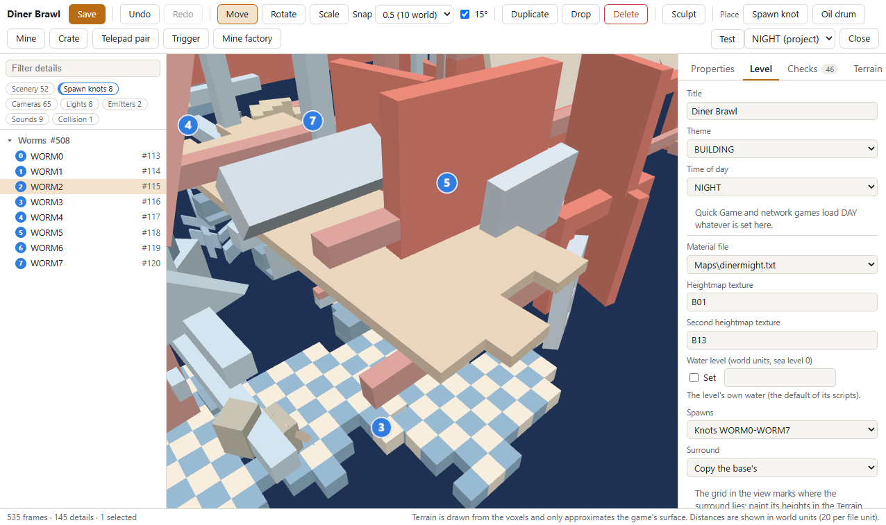
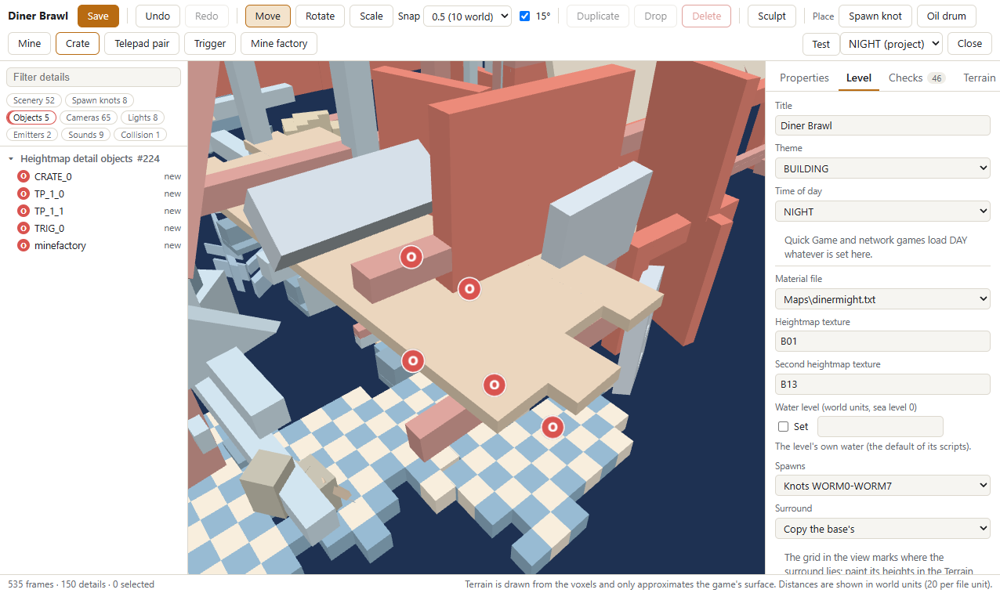
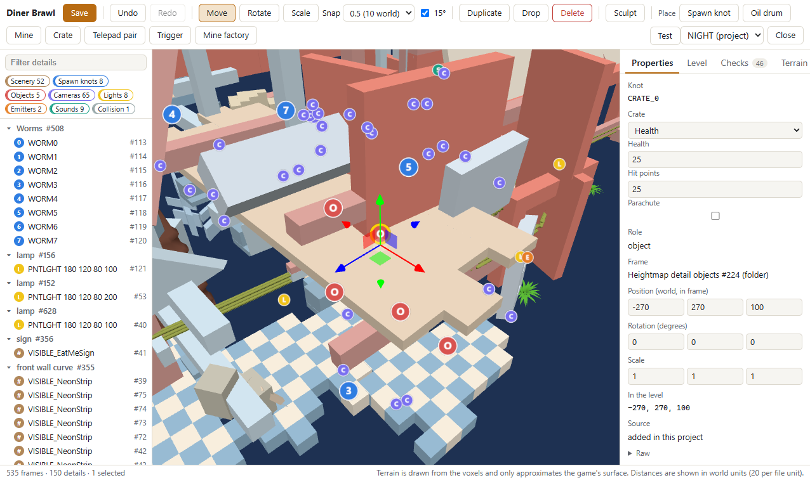
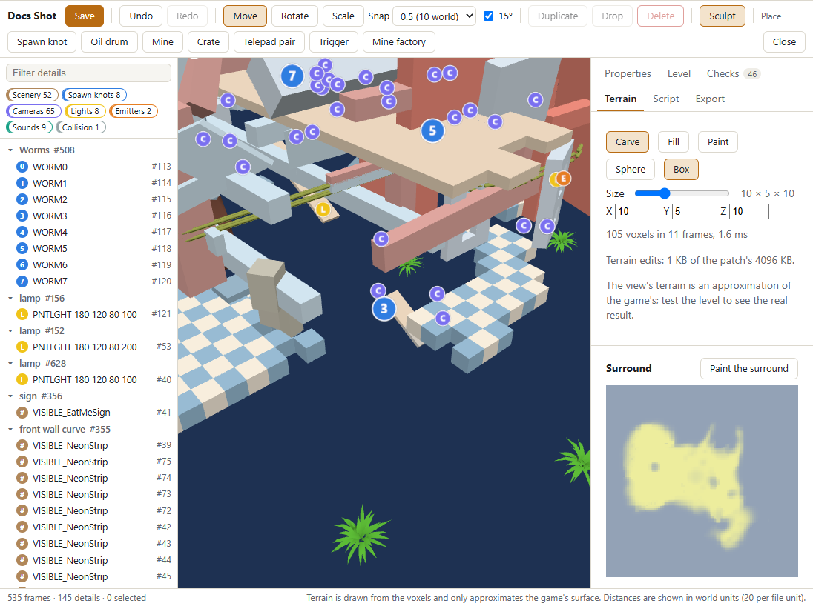
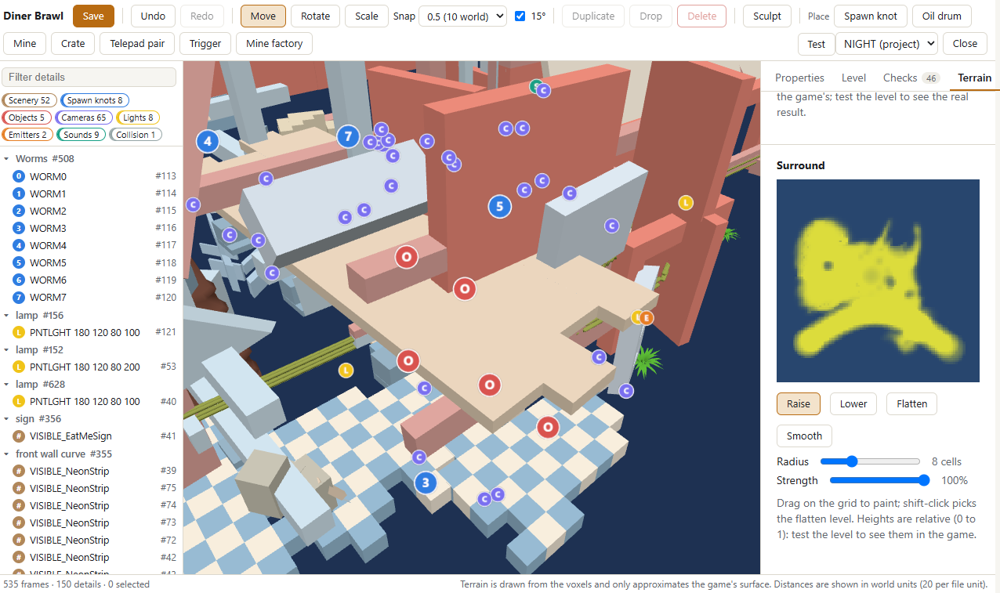
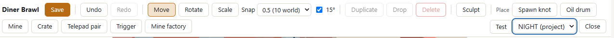
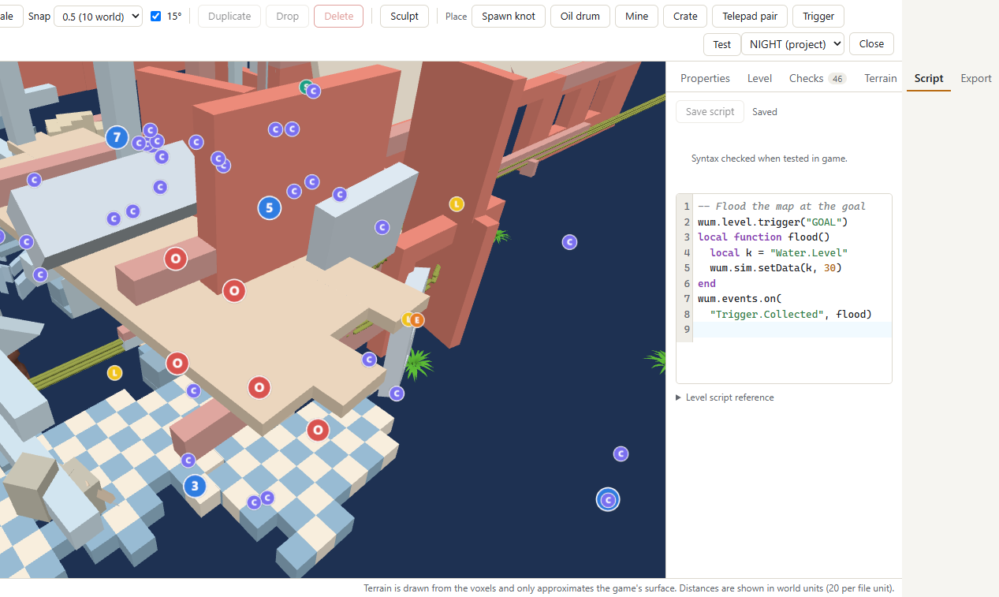

# Erg: the map editor

Erg is Oasis's level editor: it loads one of the game's own maps or a map you're already building, lets you move
spawns, place objects, sculpt the terrain and add blocks, paint the surround, add a level script, set water and theme,
and export the result as a mod. It never touches your game files directly — everything happens through the local
server (`melange.asi` with the game running, or `Melange.exe` with it closed), which is the only thing that reads `Data\`
and writes `Mods\`.

## Opening it

Open Oasis (see [oasis.md](oasis.md)) and pick the *Erg* panel, either with the game running or from `Melange.exe`
with it closed. Editing and building a pack work either way; **Test** needs the game running, at the main menu, and
not in a lobby.

## Projects

A project is one map you're editing: a base level plus your changes, saved under
`Documents\Melange\erg\projects\<id>\` (or the folder `[Erg] ProjectsDir` in `Melange.ini` names: an absolute path, or
one relative to the game folder such as `Melange\erg\projects`). The game and `Melange.exe` each read their own game
folder's `Melange.ini`, so they share projects only when both name the same folder: **Test** runs in the game and reads
the game's folder, so a project made by `Melange.exe` for another install (or with another `ProjectsDir`) is not there.
Opening the panel lists the game's own multiplayer maps and any project you
already started; pick one to start a new project from it, or an existing project to keep going. **Save** (Ctrl+S)
writes the project atomically; until then your edits and the undo history live in the page, and unsaved edits come
back as a draft if you reload it. Only one server (the game or `Melange.exe`, not both) can have a given project open at
a time. Map packs that ship only their patches (see Export) are listed at the top with a **Build** button.

## The view and tools

- **Camera:** orbit, pan and zoom with the mouse.
- **Selecting and moving:** click a spawn, object or scenery piece to select it; drag its gizmo to move, rotate or
  scale it, with snapping (1, 0.5 or 0.1 map units, and 15° steps).
- **Outliner and properties:** a tree of everything in the map on one side, and the selected thing's fields (name,
  position, rotation, scale) on the other.

- **Units:** the editor works in world units, which are 20× the numbers stored in the level file. A worm 1 map unit
  from a wall in the file is 20 world units away on screen — the same units the game's own camera and physics use.
- **Placing:** pick *Spawn knot*, *Oil drum*, *Mine*, *Crate*, *Telepad pair*, *Trigger* or *Mine factory* in the
  toolbar, then click the terrain. *Drop* (G) puts the
  selection on the ground below it; *Duplicate* (Ctrl+D) copies spawns and objects (not scenery).
- **Undo and redo:** Ctrl+Z and Ctrl+Shift+Z, up to 500 steps.
- The 3D view is an approximation of the game's own geometry, close enough to place things accurately but not a
  pixel-identical render of the game.

## Spawns

A map's spawn mode is either:

- **Random** (the default): worms land wherever the game's own random spawn logic puts them, same as an unedited
  map.
- **Knots:** place up to 8 numbered markers (`WORM0`..`WORM7`); worm *i* always starts on marker *i*. Every match
  needs all 8, even in smaller games — the map simply won't use the markers past the worm count.



## Objects

- **Oil drums** and **mines** are always placed, whatever the match's scheme.
- **Crates** hold a weapon, health or a utility; the Properties tab sets the contents, count or amount, hit points
  and parachute.
- **Telepad pairs** place two pads in one group: a worm on one pad comes out of the other.
- **Triggers** have an index, a radius and the teams that collect or destroy them; a
  [level script](#level-scripts) reacts to them.
- One **mine factory** per map. It replaces the scheme's own factory, so a match never has two. Its Properties tab
  sets the *mine target*, the *idle turns* and whether the scheme's own start mines are placed (see
  [The mine factory](#the-mine-factory)).

Crates, telepads, triggers and the mine factory sit on knots the game reads when the match starts. Using any of them
saves the project as format v2 (see [Formats](#formats)).





### The mine factory

The factory is the game's own (`MineFactoryLogicEntity`), placed by `GameLogic.PlaceObjects` on the `minefactory` knot.
How it behaves, from the game's code:

- **It runs whatever the scheme says.** The match script (`stdvs`) reads the scheme's `MineFactoryOn` only once, in
  its set-up, to decide whether to send `GameLogic.CreateRandMineFactory` (the scheme's factory at a random spot). The
  map's chunk sets `MineFactoryOn = false` first, so there is never a second factory (the engine asserts on one). At
  every turn start with two or more alliances left, `stdvs` sends `GameLogic.StartMineFactory`, and the engine passes it
  to the level's factory, whichever made it, without looking at `MineFactoryOn`.
- **It fires on a mine count, not a timer.** Each `StartMineFactory` counts down the *idle turns*
  (`NumTurnsInactive`, 7 in the game's data; the count starts when the factory is placed). Once it reaches 0, the
  factory checks at every turn start: it fires only when fewer mines than its *mine target* (`NumMineActivation`, 20)
  are in the level, counting every mine (the scheme's, placed ones and its own), and then launches
  min(target - mines, 10) of them and starts the idle count again. While the level holds 20 or more mines it does
  nothing, turn after turn.
- That is why a log shows `StartMineFactory` at every turn but only one fire: after its idle turns the factory tops
  the level up to its target once (the scheme's 15 start mines and the map's placed ones already count), and while
  those mines lie unexploded the count stays at the target, so the later checks do nothing. Start mines at or above
  the target mean it never fires at all; to keep it busy, raise the target, lower the idle turns, or turn the
  scheme's start mines off.
- **It drops onto the land first.** When it is placed it drops from its knot onto the land below (a sweep of at most
  1000 world units) and stands where it lands. A sweep that hits nothing leaves it at a stale point of the match, often
  far away and under the sea; on Tests it never landed on a smooth (draped) skin, so stand it on an undraped block
  (erg-mcp checks this, see [erg-mcp.md](erg-mcp.md)).
- **Water destroys it.** When the water level rises more than 10 world units above where it stands it explodes
  (`WXP_Explosion_MineMachine`) and is gone for the match.
- **Where its mines go.** The game rains them onto the level's living worms and objects: each fire picks one of them at
  random per mine, offsets it by a random angle and radius and drops the mine from high over it (0, -0.3, 0), so on
  Caldera they landed 28-95 map units from a crater factory, at the worms. The game's data still names
  `MineVelocityX/Y/Z`, but they are obsolete and unread. Since Melange 0.13 `launchHeight` and `launchRadius` put them
  round the factory instead (below).

The settings, all optional (unset keeps the game's value):

| Setting | Game value | Effect |
|---|---|---|
| Mine target (`activation`) | 20 | Fires when fewer mines than this are in the level, topping up to it (at most 10 per fire). 0 never fires |
| Idle turns (`inactiveTurns`) | 7 | Turn starts it waits after it is placed and after each fire. 0 checks every turn |
| Scheme's start mines (`schemeMines`) | on | Off: the scheme's 15 random mines are not placed (its 10 oil drums still are, if the scheme has them), so mines come from the factory and the map's own placed mines only |
| Stay at its knot (`keepKnot`, erg-mcp only) | off | On: when the factory's drop from its knot misses (no land under it, or a hit that is not under the knot, as over a draped skin), it stays at its knot instead of the stale point the game would leave it at (Melange 0.13+) |
| Launch height (`launchHeight`, erg-mcp only) | unset | 1-255 map units: each mine of a fire appears this high over the factory and falls from there (20 when only the radius is set), instead of over a random worm or object (Melange 0.13+) |
| Launch radius (`launchRadius`, erg-mcp only) | unset | 0-255 map units: the mines appear at random spots within this radius round the factory (an even spread over the disc), so they land round it: on a volcano, on the cone round the crater (Melange 0.13+). Tried on 2026-11-08 (Multi.DinerMight, height 25, radius 8): four fires of 10, 7, 2 and 7 mines, the mines at rest 5.7-14.4 map units from the factory |

The target and the idle turns are the game's shared `kMineFactoryData`: Melange writes them when the map's match is
set up and puts the game's values back when it ends, so no other map (and no other player's match) sees them. They
need a game build Melange knows (the sim tweak store); on another build the map plays with the game's values and the
log says so. *Scheme's start mines* is done by the map's own chunk, on the match's copy of the scheme, whatever the scheme's own
setting, and the log says so when the level starts (`the scheme's start mines are off`).

The level-start write alone did not reach the factory: by the time the match places it, `kMineFactoryData` holds the
game's 20 and 7 again (Tests of 2026-11-08: a level asking for 16 and 3 found 20 and 7 at the factory's set-up, and its
first fire came after the game's 7 idle turns). Since Melange 0.13 the factory's own set-up writes the level's values
again just before it reads them, and the log says what it found and wrote (`the mine factory's set-up:
kMineFactoryData.NumMineActivation 16 (was 20): ok, ...`) and where its drop put it; erg-mcp's `test` answers the same.

## Water

Set a water level or leave it at the map's own default. The number is in world units, with sea level at 0; on Diner
Might, 150 floods nearly everything.

## Theme and time of day

Changing the theme swaps the terrain's material and texture set (for example, Camelot's stone-and-banner look) and
loads that theme's own height-map textures; it doesn't rewrite the terrain itself. Quick Game and network games load
every map in daytime, whatever the project's time of day says. To see the map at evening or night, pick that time
for **Test** (see [Testing your map](#testing-your-map)).

## Terrain

Press **Sculpt**, then drag over the terrain to carve, fill or paint with a box or sphere brush (the *Terrain* tab sets
the mode, shape, size and material; `[` and `]` resize the brush, and Alt-drag still orbits). Fill with *Match
column* takes the material of the terrain above. Fill and paint stay inside the piece of terrain the stroke started
on.

**Blocks.** *Add block* places a new solid block of the brush's size (1-31 voxels a side) and material: click the
terrain and the block rests there, its corner snapped to whole map units. *Scale* (0.5-4, default 1) makes each voxel
that many map units across, so a block of 31 at scale 2.5 is about 78 map units wide for the same cost; the game's own
maps use scales of 1.2-2.0. A block can be sculpted like any other terrain, and the *Terrain* tab lists the blocks with
a *Remove* button. A map holds up to 64.

**The cell budget.** The game counts every cell of every voxel frame of a map, solid or empty, base and added (X x Y x
Z of each), and crashes loading a map past 65 535. The game's maps use about 8 000-46 000, and the *Terrain* tab shows
the current count. *Add block* refuses a block that would pass it; a project over it (made by an older Melange) still
opens and saves, with a warning, but Export, Build and Test refuse it. Clearing base terrain does not free cells (the
frames stay); a larger scale covers more ground with the same cells.

**Second material (experimental).** *2nd material* paints one of the level's materials (named from its material file)
over solid voxels; the voxels next to the brush take it on the corners they share, so it blends at the edge. *Remove*
restores what the map had. The corner mask also shapes collision slightly, so test the map.



## Surround

The *Surround* setting keeps the base map's far-off scenery ring (*copy*), removes it (*none*) or flattens it
(*flat*).

*Painted* lets you reshape it: the **Terrain** tab shows the surround as a 100×100 top-down grid, starting from the
base map's heights. Drag on it with *Raise*, *Lower*, *Flatten* (shift-click a cell to pick its height) or *Smooth*.
Heights run from 0 to 1 and are relative; test the map to see them in the game. A changed surround also rebuilds
the level's shadow cache, and a painted one saves the project as format v2.



## Testing your map

Press **Test** to play the map as it stands, without exporting or restarting anything:

1. Pick a time of day next to the Test button: *DAY*, *EVENING* or *NIGHT*. It starts at the project's own setting
   and applies to this Test only.
2. Erg builds your changes into a private, offline-only copy of the map (never your `Mods` folder).
3. It registers that copy for one session and arms a one-time override so the very next match loads it.
4. If your game build supports starting a match from the editor directly, Test starts Quick Game itself. Otherwise
   the status line asks you to press Quick Game yourself — the override is already armed, so that press loads your
   map.



A Test map never appears to anyone else and never starts in an online match; it's for checking your own work before
you export.

**Clean-room Test** (erg-mcp's `test` and the `level.test` call, not yet a button): `cleanMods` keeps every enabled
content mod's sim code (`entry.sim`) out of the Test match, so only the map's own chunk and level script run, and
turns the post-FX stack off; `postfx: false` turns the post-FX stack off alone (as the Post-FX panel's *Bypass all*
does). Both last until the Test match ends, fails or is disarmed, and nothing is saved. What a mod installed at
launch stays: its weapon clones and data, file overrides, shader mods and client scripts. Testing again after another edit simply overwrites the same private copy.

## Level scripts

The **Script** tab holds the map's own Lua, saved in the project as `script.lua`. It runs in the match's sandbox,
the same one a content mod's `entry.sim` gets (see *Sim scripts* in [developer-guide.md](developer-guide.md#sim-scripts)),
after every mod's sim script and only when this map is the one being played. **Save script** (Ctrl+S) checks the text
first and marks the line of any problem; Test saves it and runs the saved text, so an edit followed by another Test
needs no restart. Export ships it as `sim/<slug>.lua` and names it in the level's `levels[].sim` in `spice.json`.
`Melange.exe` compiles it too (never runs it), with a stock Lua 5.0.1 parser, the same dialect as the game's.



```lua
wum.level.trigger("GOAL", { radius = 80 })
wum.events.on("Trigger.Collected", function()
  wum.sim.setData("Water.Level", 30)
end)
wum.events.on("sim.turnStarted", function(name, turn)
  if math.mod(turn, 5) == 0 and wum.level.knots["CRATE1"] then
    wum.level.crate("CRATE1", { kind = "health", amount = 50 })
  end
end)
```

| Name | Purpose |
|---|---|
| `wum.level.stem`, `wum.level.key` | This map's file stem and registry key (`Multi.<stem>`) |
| `wum.level.knots` | Read-only table of the map's named knots, name → kind (no positions) |
| `wum.level.trigger(knot [, opts])` | A trigger at a knot; `opts`: `index`, `radius`, `teamCollect`, `teamDestroy`, `hitpoints`, `wormCollect`. `true`, or `nil` and a reason |
| `wum.level.crate(knot [, opts])` | A crate at a knot; `opts`: `kind` (`weapon`, `health`, `utility`), `contents`, `count`, `amount`, `hitpoints`, `parachute` |
| `wum.level.mine(pos [, vel])` | A mine at `pos` (`{x, y, z}` or `{x = .., y = .., z = ..}`, world units), moving at `vel` (default `{0, -0.3, 0}`, the factory's own), made by the game's own mine maker as the factory's mines are. `true`, or `nil` and a reason (`before the first turn`, `unavailable` on a game Melange does not know) |
| `wum.level.fireFactory([{now = true}])` | The map's mine factory fires at the next turn start (its idle countdown is set to 0), when fewer mines than its target are in the level; `now` sends `GameLogic.StartMineFactory` at once, so it fires in this tick. `nil` and a reason when there is no factory, it has exploded or it is firing |
| `wum.events.on("sim.turnStarted", fn)` | `fn(name, turn, round)` at the first tick of each turn, on every machine at the same tick. `turn` counts from 1, the match's n-th turn start: the same number as `wum.game.turn().index`, erg-mcp's `game_state` turn and `check_flood`'s game turns. In a Quick Game of two teams of four, turn 1 is the human team's WORM0, then WORM4, WORM1, WORM5, ... (the teams alternate, each moves its worms in turn) |
| `wum.sim.turn()`, `wum.sim.round()` | Turns started in this match, and the round: it goes up when a team starts a turn it already had in the current round, so a team that is wiped out only shortens the round. Both 0 before the first turn |
| `wum.sim.waterSchedule{startTurn, every, step, cap, from, units}` | Raises `Water.Level` at turn starts (see below) |
| `wum.sim.announce(text [, seconds])` | Shows `text` (at most 160 bytes of UTF-8) centred near the top of every player's screen for `seconds` (0.5 to 15, default 4); up to three at once, the oldest replaced. Draws only: the match, Wormsign and replays are untouched, so it is safe in deterministic code. Detect it with `if wum.sim.announce then ... end` |

**Rising water.** `wum.sim.waterSchedule{ startTurn = 3, step = 1, cap = 8, units = "map" }` raises the water by
`step` at the start of turn 3 and of every turn after it (every `every` turns, default 1) until it reaches `cap`; with
`from`, the first step sets the level to `from` and each later one to `from` plus the steps so far. It only ever
raises (a level already higher, from sudden death for instance, is kept) and never passes `cap`. `units` is
`"world"` (the default) or `"map"` (x20). It runs before the turn's `sim.turnStarted` handlers, so they see the new
level; `wum.sim.waterSchedule()` returns the next turn it steps on and the cap (world units), or `nil` once it is done,
and `wum.sim.waterSchedule(false)` stops it. One schedule per script; a new call replaces it. Bad options raise.

```lua
-- Mines from the crater: one dropped on turn 1, and the factory fired on turn 6 whatever its idle turns.
wum.events.on("sim.turnStarted", function(name, turn)
  if turn == 1 then wum.level.mine({x = 0, y = 900, z = 0}) end
  if turn == 6 then wum.level.fireFactory({ now = true }) end
end)
```

Both run in the sim, so every machine makes the same mines at the same tick (tried in a Test on 2026-11-08: the mine
appeared at turn 1, and the factory, idle turns 3, fired its 10 mines at the start of turn 2).

```lua
-- Flood from turn 3, one map unit a turn, up to 8 map units (160 world); announce each round.
wum.sim.waterSchedule{ startTurn = 3, step = 1, cap = 8, units = "map" }
wum.events.on("sim.turnStarted", function(name, turn, round)
  if round ~= lastRound and wum.sim.announce then wum.sim.announce("Round " .. round) end
  lastRound = round
end)
```

Everything else (`wum.events`, `wum.sim.*`, `wum.log`) is the sim script API. In logs and in Wormsign the script is
named `<mod id>:<slug>` (`erg:<project>` while testing).

**Sandbox limits.** No engine globals (`SendMessage` and friends are `nil`), only the messages the sim allows
(`GameLogic.PauseGame` and the like are refused), and an instruction budget per call (`[SimBridge] InstrPerCall`): a
callback that errors or runs out of budget three times is switched off, and the match goes on. A script is at most
256 KB of UTF-8 text with no byte order mark; compiled Lua is refused.

**Determinism.** Every machine in a match runs the script and must reach the same result, so:

- use `wum.sim.random` (`math.random` is the same stream), never the clock or anything local to one machine;
- numbers are floats (exact integers only up to 2^24), and it's Lua 5.0: `table.getn(t)` not `#t`, `math.mod` not `%`;
- a closure inside a loop sees the loop variable's last value, so copy it into a `local` first;
- keep state in globals or `wum.sim.storage` (Wormsign hashes those) or pass it to `wum.sim.hash`.

Online, everyone must have the same pack version, which covers the script's bytes, and a replay refuses to play if
the level script has changed since it was recorded.

## Export

Exporting turns a project into a mod under `Mods\`, in one of two forms:

- **Source** (recommended for sharing): just your edits — a small JSON file plus a build script. Whoever receives it
  runs the build script against their own copy of the game to produce the actual map files. Nothing of the game
  itself travels in this form, so it's the right way to share a map with someone else.
- **Install** (for your own machine only): the full, ready-to-play map files, generated from your edits against your
  own install. This form contains modified copies of game files and should stay on your computer — don't redistribute
  it.

Either way you give the export a mod id, a display name and a version; exporting into a mod id you've already used
adds the new map alongside any others already in it (or updates it, if you export the same map again). Whether it
needs a restart is covered under [Live packs](#live-packs); the dialog tells you.

If you choose Source, the recipient enables the mod and either presses *Build* in Erg or runs its `build.ps1`, which
needs nothing but their own game install; either produces byte-identical files to what Install would have written
on your machine.

## Playing an exported map

An exported map appears under *Prebuilt* in Versus, exactly like one of the game's own maps, once the mod that ships
it is enabled.

### Survivor copies

The export dialog's *Survivor copy* box (on by default) also lists the map in Survivor: Local Game, Versus,
Survivor, *Landscape*, then the *Prebuilt* section, under the same title. The copy uses the same files, spawns,
objects, water and level script as the map itself, and runs the game's Survivor rules on top. It is always unlocked,
whatever the base map's lock is in your save. In `spice.json` it is the level's `"survivor": true`.

- Maps are registered at the main menu, before any Survivor screen is opened. A pack enabled or disabled at the menu
  ([Live packs](#live-packs)) shows up or disappears in Survivor once you leave the screen and open it again.
- Online, a Survivor copy follows its map's rules below: everyone needs the same version of the mod.
- `[Levels] RandomPool=0` (the default) keeps both the map and its copy out of the game's random picks, Survivor's
  included.
- The game remembers the last Survivor map you picked. When that map's mod is no longer enabled, Melange puts a
  vanilla Survivor map back in its place at the main menu, so a lobby never starts on a map that isn't there.

### Live packs

A pack of maps can be enabled or disabled on the Mods page without a restart when:

- the game is at the main menu, offline, not in a lobby, and no Test is running;
- the pack holds only maps. A pack with level scripts or `entry.sim`, weapons, messages, client code or file overrides
  needs a restart.

A map enabled this way plays offline only until the next restart; online, a start on it is held with a banner. Set
`[Levels] LivePacks=0` to turn live packs off.

**Online rules:** a map you made plays online only when everyone in the lobby has the exact same version of the mod
that ships it — Melange checks this automatically. If anyone doesn't match, the host's selection of that map is held
with a banner naming who's missing it, and maps you've only Tested never start online at all. A vanilla player simply
can't pick your map to begin with.

## Formats

A project or Source export is saved as `erg-patch/1` unless it uses level objects, a level script, added blocks or a
painted surround; then it is saved as `erg-patch/2` (and its scene as `erg-scene/2`). This Melange reads both: a v1
project opens and saves as before, and becomes v2 only once you use one of those features. There is nothing to migrate
by hand. An older Melange that knows only v1 refuses a v2 project or pack by its format, so players need this version
or later to build or play a v2 map; a painted second material needs it too. The schemas are
[erg-patch-2.schema.json](erg-patch-2.schema.json) and [erg-scene-2.schema.json](erg-scene-2.schema.json).

A map with spawns, objects or water exported or built by this Melange needs this Melange or later: its generated chunk
now does its set-up when the match starts (the form Survivor needs), and an earlier Melange refuses that chunk and a
Survivor copy. Packs exported by an earlier Melange keep working unchanged.

## Limits

- Up to 32 maps in one mod, 128 across every enabled mod at once.
- A map title is 1-40 plain-ASCII characters.
- Up to 64 added blocks per map, each side 1-31 voxels, scale 0.5-4 (0.75 played in the game; under 1 is finer than
  the base map's voxels at the same cost per cell). A block may carry corner offsets (the patch's `addFrame.corners`,
  the frame's HeightMap, -64..64 voxels), which the game uses to shear each column up for drawing and collision; erg-mcp's
  `heightfield_drape` makes them, and the panel's 3D view draws such a block unsheared. The game asserts on a side of
  32: a block of 32 made by an older Melange still opens, and saving names it in a warning (remove it and add it again
  at 31).
- At most 65 535 voxel cells per map, counted over every voxel frame (see [the cell budget](#terrain)): saving warns
  past it, and Export, Build and Test refuse.
- The game draws terrain from a mesh with a vertex budget of its own. A large area where every column's top voxel is a
  different material from the voxel under it (a one-voxel skin) has run out of it in a test (holes in the drawn
  terrain, `CombineLandscapeAction` lines in the log); bands of material by height did not. Test large terrain.
- A patch (your saved edits) is capped at 20 000 operations and 4 MB — enough for any hand-made edit; if you hit
  this, split the changes into more than one exported map.
- Not yet supported:
  - per-team or story spawn points, and story or challenge map types;
  - editing the map's generated chunk (Erg rewrites it every export; use a [level script](#level-scripts));
  - enabling a pack with level scripts without a restart (see [Live packs](#live-packs)).
- A replay recorded on a Test map only plays back correctly while your Test workspace still has the same files —
  moving on to a different edit, or exporting for real, can make an older Test recording unplayable.

## Troubleshooting

- **A map you enabled doesn't show up:** it needs a restart after being enabled, like any content mod; check the
  Mods page for "restart required".
- **"Not built"** on a Source-form mod: press *Build* in Erg, or run the mod's `build.ps1`, then restart.
- **Test is greyed out or missing:** the game needs to be running, sitting at the main menu, and not in a lobby;
  `Melange.exe` has no Test.
- **A map is missing online, or a teammate's start is held:** everyone needs the exact same version of the mod; check
  who's missing it in the lobby panel.
- **Something looks wrong in the 3D view but fine in-game (or the reverse):** the editor's view is an approximation;
  trust Test (which runs the real game) over the preview for anything that matters.
- For anything else, the game's log has an `[erg]`/`levels` line naming what happened at each step (registration,
  test starts, exports) — attach it if you report a problem (see the main [README](../README.md#reporting-a-bug)).
